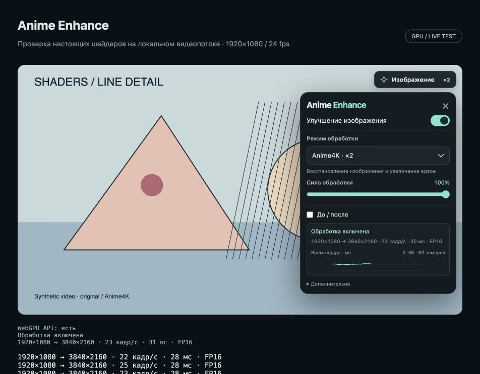

# Anime Enhance

  

Отдельное расширение для улучшения изображения аниме прямо в браузерном плеере. Версия **0.2.0** для Arc и Chromium-браузеров с WebGPU.

**[Скачать расширение 0.2.0](https://github.com/MixNot/anime-enhance/releases/download/v0.2.0/anime-enhance-0.2.0.zip)** · [Что нового](CHANGELOG.md) · [Все релизы](https://github.com/MixNot/anime-enhance/releases)



## Установка

1. Скачай готовый ZIP по кнопке выше и распакуй его. Оставь папку `anime-enhance` в постоянном месте. Сборка из исходников для установки не нужна.
2. Открой `arc://extensions` в Arc или `chrome://extensions` в Chrome.
3. Включи **Developer mode / Режим разработчика**.
4. Нажми **Load unpacked / Загрузить распакованное расширение** и выбери папку с `manifest.json`.
5. Перезагрузи вкладку AnimeLib, открой серию и запусти видео.
6. Нажми **«Изображение»** в правом верхнем углу плеера и включи обработку.

По умолчанию обработка выключена. Для собственного плеера Animelib нужно войти в профиль сайта. Расширение независимо от AnimeLib Skip и может использоваться вместе с ним.

## Обновление с 0.1.0

Если расширение загружено из этой же папки, нажми **⟳ / Перезагрузить** на карточке Anime Enhance на странице расширений. Затем перезагрузи вкладку с серией. Если папка другая, перенеси в неё файлы новой версии перед перезагрузкой расширения. Настройки хранятся отдельно и сохраняются. Новый доступ к сайтам не требуется.

В 0.2.0 убран режим почти незаметной лёгкой резкости. Добавлены быстрый нейросетевой ×2, график времени кадра и два вида сравнения. У селектов своя ровная стрелка. Панель прокручивается, когда не помещается в плеер.

## Режимы

| Режим | Обработка | Размер результата |
| --- | --- | --- |
| Anime4K · мягкий | CNNSoftM и ограничение пересветов | Исходный |
| Anime4K · ×2 быстрый | CNNx2M и ограничение пересветов, без отдельной модели восстановления | Вдвое по каждой стороне |
| Anime4K · ×2 | CNNM + CNNx2M и ограничение пересветов | Вдвое по каждой стороне |
| Anime4K · ×2 HQ | CNNVL + CNNx2VL и ограничение пересветов | Вдвое по каждой стороне |

Режим и сила обработки выбираются вручную. **Автоматического снижения качества, смены модели или уменьшения разрешения нет.** Если выбранный режим слишком тяжёлый, выбери другой сам. Скрытая вкладка не обрабатывается до возвращения к ней.

Галочка **«До / после»** включает сравнение одного и того же кадра: слева оригинал, справа обработка. Доступны **подвижная граница** с ползунком и **два полных кадра рядом** с сохранением пропорций. Когда галочка снята, весь кадр обработан. Отключение обработки целиком — верхним переключателем. Оригинал при сравнении отображается обычным линейным масштабированием на ту же поверхность.

## Производительность и график

После прогрева цепочка GPU-команд переиспользует готовые пайплайны без ожидания компиляции каждого прохода на каждом кадре. Когда GPU занят, сохраняется только самый свежий ожидающий кадр. Как только GPU освобождается, обработка продолжается сразу. Очередь старых кадров не накапливается. Смена силы эффекта или вида сравнения использует уже обработанный кадр, пока не появился новый.

**Дополнительно → Вычисления FP16** — необязательное ручное ускорение CNN. По умолчанию выключено. Модели, число слоёв и выходное разрешение сохраняются; точность арифметики ниже, возможны небольшие отличия результата. Если видеокарта не поддерживает FP16, показывается ошибка, автоматического переключения нет. [Описание поддержки FP16 в WebGPU](https://developer.chrome.com/blog/new-in-webgpu-120).

График показывает среднее время обработки кадра за последний интервал, включая отправку команд и ожидание GPU. Это не процент загрузки видеокарты и не чистый GPU timestamp. Используется уже собираемая статистика: максимум 60 последних замеров, обновление примерно раз в секунду только при открытой панели. Отдельного таймера, цикла анимации, чтения пикселей или GPU-прохода для графика нет. Накладные расходы небольшие, но строго нулевую нагрузку обещать нельзя.

## Что сохраняется

Настройки хранятся локально в браузере. Звук, управление воспроизведением, качество исходного потока и субтитры остаются у сайта. Расширение не меняет адрес видео и не загружает его повторно. Обработка работает на видеокарте твоего устройства, файлы шейдеров включены в расширение.

## Доступ

Запрашивается доступ к страницам `animelib.org` и кадрам `kodikplayer.com` с поддоменами, а также разрешение `storage` для настроек. Код Kodik активируется только при встраивании в AnimeLib. Пароли, cookies и история не читаются; внешних запросов и отправки видео на сервер нет.

## Ограничения первой версии

- Требуется работающий WebGPU и аппаратное ускорение браузера. Проверяется наличие поддержки; расширение не изменяет защитные настройки браузера.
- Сторонний видеосервер может запретить обработку кадров через CORS. Тогда выводится сообщение, а исходное видео сохраняется. Kodik зависит от конкретного потока и не гарантирует доступ к кадрам.
- При обычном полноэкранном режиме контейнера плеера обработка остаётся внутри него. Стандартное «Картинка в картинке» показывает исходное видео.
- HQ может заметно нагружать видеокарту и расходовать батарею. Тяжёлый режим сохраняется выбранным даже при пропуске обработанных кадров.
- Переключение серии и исходного разрешения пересоздаёт обработку с тем же выбранным режимом.

## Проверка версии 0.2.0

Сравнение на одном устройстве в браузере, на локальном синтетическом потоке 1920×1080 / 24 кадр/с с выходом 3840×2160:

| Вариант | Наблюдаемая частота обработки |
| --- | --- |
| 0.1.0 · ×2 | около 18–20 кадр/с |
| 0.2.0 · ×2, FP32 | около 21–23 кадр/с |
| 0.2.0 · ×2, FP16 вручную | около 24 кадр/с |
| 0.2.0 · ×2 быстрый | около 24 кадр/с |
| HQ, включая FP16 | около 6–7 кадр/с, существенного ускорения не получилось |

Это наблюдавшиеся значения в отдельных отрезках, а не гарантия длительной стабильности. В продолжительном фоновом тесте также наблюдались значительные просадки скорости. Частота и задержка зависят от потока, браузера, температуры и другой нагрузки. Старый счётчик показывал время отдельного кадра; новый усредняет время за интервал, поэтому цифры в миллисекундах напрямую сравнивать нельзя. Результаты не гарантируют такой же скорости на каждом видео или GPU. HQ сохранён для ручного выбора, но в этом тесте не подходит для плавного просмотра 1080p → 4K.

Прошли 12 автоматических проверок, включая порядок GPU-команд, ограничение очереди самым свежим кадром, повторное использование обработанного кадра для сравнения, переключение сравнения, ограничение истории графика и ручной FP16. Все режимы выводят реальные GPU-кадры; доступность меню сама по себе не считается проверкой обработки. Совместимость версии 0.2.0 с конкретной серией AnimeLib и потоком Kodik нужно проверить после обновления установленного расширения.

## Сборка из исходников

Нужен Node.js 22.22.2+ в ветке 22 либо 24.15+ в ветке 24 (требование тестового jsdom). В архиве исходников:

```sh
npm ci
npm run build
npm test
```

По умолчанию сборка записывается в `extension/`; можно задать папку через переменную окружения `ANIME_ENHANCE_OUTPUT`. Тесты читают ту же папку. Готовая папка `extension/` также хранится в репозитории; при установке из ZIP исходников выбирай именно её. Экспериментальные и сравнительные файлы не требуются для работы расширения.

Основа нейросетевых шейдеров: [Anime4K-WebGPU-Async](https://github.com/daika7ana/Anime4K-WebGPU-Async), на базе [Anime4K](https://github.com/bloc97/Anime4K). Лицензии находятся в `THIRD-PARTY-NOTICES.txt`.
